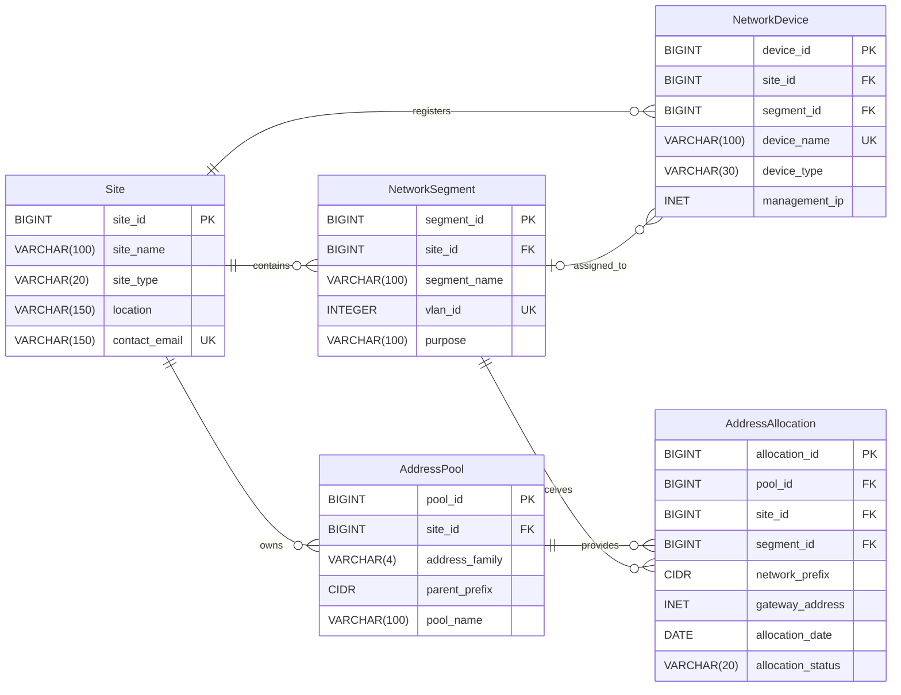

# LearnNaija Network Address Management System ER Diagram

## 1. Entity Relationship Diagram

The diagram represents the five entities in the LearnNaija Network Address Management System, their attributes, keys and relationships.

**Note on unique fields:** The `UK` marker on `vlan_id` represents the combined unique constraint on (`site_id`, `vlan_id`). Similarly, the `UK` marker on `device_name` represents the combined unique constraint on (`site_id`, `device_name`). Neither field is unique by itself. The `contact_email` field is individually unique when a value is provided.

## 2. Explanation of keys and relationship symbols

**Primary Key (PK):** A primary key uniquely identifies each record in a table. For example, `site_id` uniquely identifies every registered site.

**Foreign Key (FK):** A foreign key connects one table to another and ensures that a referenced record exists. For example, `site_id` in `NetworkSegment` references the `Site` table.

**Unique Key (UK):** A unique constraint prevents duplicate values or combinations of values. For example, a site cannot have two network segments with the same VLAN ID.

### Relationship symbols

| Symbol | Meaning |
|---|---|
| `||` | Exactly one |
| `o|` | Zero or one |
| `o{` | Zero or many |

The relationship between `Site` and `NetworkSegment` means that one site can have zero or many network segments, while every network segment belongs to exactly one site.

The relationship between `NetworkSegment` and `NetworkDevice` allows a device to have no assigned segment or belong to one segment. A segment can contain zero or many devices.

## 3. Optional fields

The following fields are optional in the database design:

- `Site.contact_email`: A site can be registered without a contact email.
- `NetworkDevice.segment_id`: A device can exist without an assigned network segment.
- `NetworkDevice.management_ip`: A device can be recorded without a management IP address.
- `AddressAllocation.gateway_address`: An allocation can exist without a recorded gateway address.

All other listed attributes are required.

## 4. Additional constraints and transaction logic

Some business rules require additional database constraints or controlled operations beyond the primary and foreign keys shown in the diagram.

1. **Address pool validation:** An allocation operation checks that an IPv4 subnet or IPv6 prefix falls within its assigned parent address pool.
2. **IPv6 prefix length:** Additional checks or allocation operations enforce `/64` prefixes for standard user and server VLANs and `/127` prefixes for point-to-point links.
3. **Overlapping allocations:** A database trigger or controlled allocation operation checks that active address allocations do not overlap within the same pool. Transaction control is also important to prevent simultaneous allocations from creating conflicts.
4. **Composite foreign key:** The combination of `site_id` and `segment_id` in `AddressAllocation` references the corresponding combination in `NetworkSegment`, ensuring that the allocation belongs to the correct site. The referenced pair must have a unique constraint.
5. **Address family validation:** Checks ensure that the address family in `AddressPool` agrees with its parent prefix and that each allocation uses the same address family as its pool.
6. **Allocation approval:** Database roles or an authorised application layer restrict approval and release actions to network administrators.

## 5. Case study example

At the LearnNaija Abuja headquarters, a staff network segment is registered with its own VLAN ID. The segment can receive an IPv4 subnet and a separate IPv6 prefix through `AddressAllocation`. Both allocations reference the appropriate address pool and the same network segment.

This design provides a structured way to manage network sites, devices, VLANs and IPv4/IPv6 address allocations while supporting accurate record-keeping and future network expansion.
